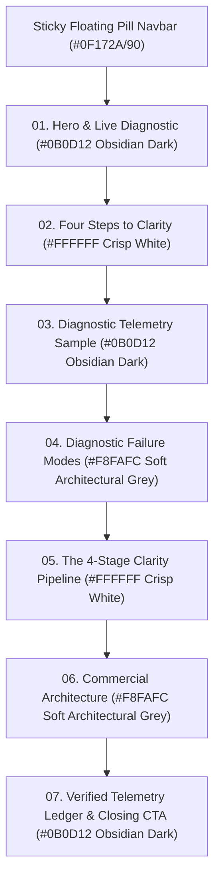

# AEObility Staging Homepage Design Specification: "The Clarity Engine"

**Canonical Staging Routes:**
- **Next.js App Router Component:** [`src/components/staging/ClarityEngineStaging.tsx`](file:///c:/Users/vince/agy2/projects/aeobility/src/components/staging/ClarityEngineStaging.tsx) (`/staging/clarity-engine`)
- **Static HTML Preview:** [`public/clarity-engine.html`](file:///c:/Users/vince/agy2/projects/aeobility/public/clarity-engine.html) (`/clarity-engine.html`)
- **Floating Assistant Overlay:** [`src/components/AIModalAssistant.tsx`](file:///c:/Users/vince/agy2/projects/aeobility/src/components/AIModalAssistant.tsx)

---

## 1. Design Philosophy & Core Objectives

The **AEObility Clarity Engine** staging homepage is engineered around three primary objectives:
1. **Cognitive Load Reduction (Layer-Cake Scanning):** Alternating deliberately between **Obsidian Dark (`#0B0D12`)**, **Crisp White (`#FFFFFF`)**, and **Soft Architectural Grey (`#F8FAFC`)** with `#E5E7EB` structural borders. This rhythmic light/dark alternation eliminates dark-mode tunnel vision, establishes clear chapter breaks (`py-24` / `96px` vertical buffers), and grounds commercial purchasing decisions on high-trust light surfaces.
2. **Conversion Psychology & Attention Budgeting:**
   - **Hick's Law:** Enforces a single primary conversion action per viewport. Secondary paths (such as the Hero Blueprint jump-link, failure mode inspection links, and secondary pricing tiers) are demoted to plain text links or muted `#E5E7EB` ghost buttons.
   - **Von Restorff Effect (Isolation):** Primary conversion buttons own a dedicated high-contrast fill (`#22D3EE` solid cyan with `#090D16` text on dark sections; `#0F172A` solid obsidian with `#FFFFFF` text on the featured `$995` Blueprint card), ensuring immediate visual isolation under a squint test.
   - **Law of Proximity:** Friction reducers and risk-reversal guarantees (such as *"Instant baseline scan · Zero email required upfront"* and the *"100% Credit Guarantee"*) are placed directly adjacent to their respective conversion triggers.
3. **WCAG 2.2 AA Accessibility & Readability:**
   - All body copy, secondary metadata, and form labels exceed the **4.5:1** minimum contrast threshold across both dark and light surfaces.
   - Form inputs use programmatically associated `<label htmlFor="...">` elements and non-italicized placeholders (`#94A3B8` on `#0B0D12`).

---

## 2. Colour Architecture & Token System

### 2.1 Surface Tokens
| Token Role | Hex Code | Usage |
| :--- | :--- | :--- |
| **Obsidian Dark Canvas** | `#0B0D12` | Sections 01 (Hero), 03 (Telemetry Sample), 07 (Case Study Ledger & Closing Banner), and Footer. |
| **Dark Terminal Container** | `#111622` | Elevated diagnostic cards, telemetry containers, and ledger panels inside `#0B0D12` sections. |
| **Dark Structural Border** | `#1E293B` | `1px solid` crisp borders and internal dividers on `#0B0D12` and `#111622` containers. |
| **Crisp White Surface** | `#FFFFFF` | Sections 02 (Four Steps) and 05 (4-Stage Pipeline), plus elevated cards sitting on `#F8FAFC`. |
| **Soft Architectural Grey** | `#F8FAFC` | Sections 04 (Failure Modes) and 06 (Commercial Architecture), plus active tab wells on white sections. |
| **Light Hairline Border** | `#E5E7EB` | `1px solid` section seam dividers, light card borders, comparison bar tracks, and secondary ghost buttons. |

### 2.2 Typography & Steel Grey Hierarchy
| Surface Context | Element Role | Hex Code | Contrast Ratio |
| :--- | :--- | :--- | :--- |
| **Dark (`#0B0D12` / `#111622`)** | Primary Headings (`H1`, `H2`, `H3`) & Key Metrics | `#FFFFFF` | > 18:1 |
| **Dark (`#0B0D12` / `#111622`)** | Primary Body Copy & Input Labels | `#CBD5E1` (Slate 300) | ~ 12.6:1 |
| **Dark (`#0B0D12` / `#111622`)** | Micro-Labels, Captions & Input Placeholders | `#94A3B8` (Steel Slate) | ~ 6.8:1 |
| **Light (`#FFFFFF` / `#F8FAFC`)** | Primary Headings (`H2`, `H3`), Prices & Active Tabs | `#0F172A` (Obsidian Slate) | > 16:1 |
| **Light (`#FFFFFF` / `#F8FAFC`)** | Primary Body Copy & Deliverable Lists | `#475569` (Dark Steel Grey) | ~ 7.5:1 |
| **Light (`#FFFFFF` / `#F8FAFC`)** | Uppercase Metadata, Eyebrows & SKU Codes | `#64748B` (Mid Steel Grey) | ~ 4.7:1 |
| **Light (`#FFFFFF` / `#F8FAFC`)** | Inline Educational & Diagnostic Text Links | `#0284C7` (Dark Cyan) | ~ 4.6:1 |

### 2.3 Focal Gradient & Accent Discipline
- **Single Focal Gradient Rule:** `linear-gradient(90deg, #22D3EE 0%, #A855F7 100%)` (`.text-focal-gradient` / `.bg-focal-gradient`) is restricted to **one focal element per section** (either a key headline emphasis phrase or a primary progress/connector bar). It is never applied to body text, card borders, or buttons.
- **Primary Dark-Section CTA Accent:** Solid `#22D3EE` fill with `#090D16` bold typography (`hover:bg-cyan-300`).
- **Primary Light-Section Commercial Accent:** `2px solid #0891B2` border on the featured `$995 Strategic Blueprint` card, paired with a solid `#0F172A` (Obsidian) CTA button and `#FFFFFF` text.
- **Secondary Metric Accents:** Amber Gold (`#F59E0B`) for `Salience Lift (11.9% → 83.7%)`, `Answer Coverage (91%)`, and `3-5 DAYS SLA` on `AEO Sprints`; Emerald (`#10B981`) for live status indicators.

---

## 3. Navigation Shell & Viewport Hygiene

### 3.1 Adaptive Floating Pill Navbar (`sticky top-4 z-50 px-4`)
- **Geometry:** Floating rounded pill (`max-w-6xl mx-auto rounded-full border border-slate-700/70 bg-[#0F172A]/90 px-6 py-3 shadow-lg backdrop-blur-md`).
- **Visual Persistence:** Because it uses an `#0F172A` translucent dark-slate surface with a crisp `1px` border (`border-slate-700/70`) and subtle drop shadow, it remains legible over both `#0B0D12` dark sections and `#FFFFFF` / `#F8FAFC` light sections without requiring JavaScript colour-flipping.
- **Structure:**
  - **Left:** Official AEObility Isometric 3-Layer Stack SVG + `AEObility` wordmark (`bility` in `#22D3EE`).
  - **Centre:** Four restrained anchor links in `text-slate-300 hover:text-white` (`Telemetry`, `4-Stage Pipeline`, `Packages`, `Case Study`).
  - **Right:** Single compact primary action pill (`Free AI Scan →`) in solid `#22D3EE` with `#090D16` text.

### 3.2 Floating Assistant (`[Chat with AI Bill]`) Collision Prevention
- **Mobile Icon Collapse:** On narrow/mobile viewports (`< 640px`), the launcher in [`AIModalAssistant.tsx`](file:///c:/Users/vince/agy2/projects/aeobility/src/components/AIModalAssistant.tsx) collapses its text label (`hidden sm:inline`) into a compact circular icon (`p-2`) so it never obscures card telemetry metrics.
- **Intersection Suppression:** An `IntersectionObserver` automatically hides the floating assistant whenever `#hero-diagnostic-instrument` or `#final-conversion-panel` enters the viewport (`aeo:suppress-bill` custom event), and Section 07 includes extra bottom padding (`pb-32`) to prevent footer overlap.

---

## 4. Section-by-Section Architecture (7-Section Sequence)

### Section 01: Hero & Live Diagnostic (`#0B0D12` Obsidian Dark)
- **Layout:** Asymmetric 12-column split (`7 cols` editorial value proposition on the left; `5 cols` interactive diagnostic utility on the right).
- **Left Column:**
  - Status pill (`Answer Engine Optimisation for Australian Entities`) with `#10B981` indicator dot.
  - Display `H1`: *"Get your business **found and chosen** in AI search."* with `.text-focal-gradient` (`#22D3EE` to `#A855F7`) on *found and chosen*.
  - Plain-English value proposition in `#CBD5E1`.
  - Demoted secondary text link (`Explore the $995 Strategic Blueprint ↓`) paired with `#94A3B8` reassurance micro-copy (`Fixed scope · Australian specialist · Zero retainer lock-in`).
  - 3-column mini-telemetry bar (`+17% Verified`, `11.9% → 83.7%` in `#F59E0B`, `100% Applied`).
- **Right Column (`#hero-diagnostic-instrument`):**
  - Contained inside a `#111622` card with `1px solid #1E293B` border.
  - Programmatically associated `<label>` fields (`AUSTRALIAN BUSINESS DOMAIN` and `PRIMARY CUSTOMER QUERY / INTENT`) in `#CBD5E1` above `#0B0D12` input wells.
  - Solid `#22D3EE` primary CTA button (`Get AI Ready · Free Scan →`) with `#090D16` text, followed immediately by proximity reassurance (`Instant baseline scan • Zero email required upfront`).
  - 4-pill baseline readout grid (`Entity Salience 88%`, `Answer Coverage 91%` in `#F59E0B`, `Provenance 100% Parity`, `AI State Active`).

### Section 02: Four Steps to Clarity (`#FFFFFF` Crisp White)
- **Seam Hygiene:** Top and bottom `1px solid #E5E7EB` borders (`border-y border-[#E5E7EB] py-24`).
- **Header:** `#64748B` uppercase pill (`The Telemetry Engine`), `#0F172A` `H2` (*"Four Steps to Machine-Readable Clarity"*), and `#475569` Steel Grey lead paragraph.
- **4-Step Grid (`01` to `04`):**
  - Linked horizontally on desktop by a `2px` Cyan-to-Purple connector line (`.bg-focal-gradient`).
  - Individual `#FFFFFF` cards bordered by `1px solid #E5E7EB` with `#94A3B8` monospace step numbers, `#0F172A` titles, and `#475569` Steel Grey descriptions.
- **Footer Links:** High-contrast `#0284C7` plain text links to `/knowledge-hub/what-is-aeo` and `/knowledge-hub/ai-seo-tools`.

### Section 03: Diagnostic Telemetry Sample (`#0B0D12` Obsidian Dark)
- **Layout:** 12-column split (`5 cols` narrative context on the left; `7 cols` `#111622` terminal telemetry container on the right).
- **Focal Element:** `AI Visibility Index (88 / 100)` showcase featuring the single Cyan-to-Purple progress bar (`w-[88%] bg-focal-gradient`).
- **4 Signal Cards:** 2x2 grid displaying `Entity Graph Alignment (94%)`, `Answer Extraction (91%)`, `Service Proof Links (Connected)`, and `Citation Parity (100%)`.
- **Conversion Trigger:** Solid `#22D3EE` CTA button (`Run Free Live Telemetry Scan →`) with proximity reassurance directly beneath.

### Section 04: Diagnostic Failure Modes (`#F8FAFC` Soft Architectural Grey)
- **Seam Hygiene:** `border-y border-[#E5E7EB] bg-[#F8FAFC] py-24`.
- **Header:** `H2` (*"AI cannot choose what it **cannot verify.**"*) with `.text-focal-gradient` on *cannot verify.*
- **3 Failure Mode Cards (`GAP 01 // IDENTITY`, `GAP 02 // PASSAGES`, `GAP 03 // PROVENANCE`):**
  - Crisp `#FFFFFF` cards (`border border-[#E5E7EB] p-8 shadow-xs`) floating on `#F8FAFC`.
  - Gap tags rendered in `#334155` on `#E5E7EB` pills.
  - **Before / After Comparison Bars:** Muted Steel Grey (`#94A3B8`) for the "Before" baseline vs solid Dark Cyan (`#0891B2`) for the "After" state.
  - Bottom card actions demoted to `#0284C7` plain text links (`Inspect Stage 01/02/03 →`).

### Section 05: The 4-Stage Clarity Pipeline (`#FFFFFF` Crisp White)
- **Seam Hygiene:** `border-y border-[#E5E7EB] bg-white py-24`.
- **Interactive 4-Column Stage Selector (`01 Define`, `02 Connect`, `03 Prove`, `04 Measure`):**
  - Inactive stages sit on `#FFFFFF` with `1px solid #E5E7EB` borders and a `2px` `#E5E7EB` top bar.
  - The selected stage transitions to a `#F8FAFC` surface with an elevated shadow and a `3px` Cyan-to-Purple top-border highlight (`.bg-focal-gradient`).
  - Copy uses accessible business language in `#475569` Steel Grey paired with `#0891B2` checkmarks.

### Section 06: Commercial Architecture (`#F8FAFC` Soft Architectural Grey)
- **Seam Hygiene & Motion:** `border-y border-[#E5E7EB] bg-[#F8FAFC] py-24` with smooth 60fps `requestAnimationFrame` scroll parallax (`--comm-parallax`) and AOS (`data-aos`) entrance animations.
- **Asymmetric Pricing Grid (`7 cols` Featured Blueprint + `5 cols` Stacked Secondary Tiers):**
  - **Featured Card (`Strategic Blueprint · $995 AUD ex. GST`):**
    - `#FFFFFF` surface with a `2px solid #0891B2` border and `shadow-lg`.
    - Includes SKU metadata (`SKU: BPSTRAT • 5-DAY SLA`) in `#64748B`, deliverable grid, internal `100% Credit Guarantee` callout (`bg-[#F8FAFC] border border-[#E5E7EB]`), and a solid `#0F172A` Obsidian primary CTA button with `#FFFFFF` text (`Commission Strategic Blueprint →`).
  - **Secondary Cards (`AEO Foundation · $1,980/mo` & `AEO Sprints · From $495`):**
    - `#FFFFFF` surface with `1px solid #E5E7EB` borders (`p-8`), `#F59E0B` SLA highlight on `AEO Sprints` (`3-5 DAYS SLA`), and `#E5E7EB` ghost buttons (`text-[#0F172A] hover:bg-[#D1D5DB]`).

### Section 07: Verified Telemetry Ledger & Closing CTA (`#0B0D12` Obsidian Dark)
- **Part A - Verified Telemetry Ledger (`Baby Bento` Case Study):**
  - Interactive `Pre-AEO Baseline` vs `Post-90 Day Telemetry` toggle pill.
  - Ledger container in `#111622` with `#1E293B` borders.
  - Left column highlights the `Entity Salience Share Shift` (`11.89%` to `83.69%` rendered in `.text-focal-gradient`), `Avg. Citation Rank (#1.4)`, and `Passage Extraction (4.8x)`.
  - Right column displays 4 clean progress bars (`#22D3EE` and `#0891B2` fills on `#111622` tracks) and a direct link to `/knowledge-hub/case-studies/baby-bento`.
- **Part B - Closing Conversion Panel (`#final-conversion-panel`):**
  - Centered `#111622` container (`border border-[#1E293B] p-8 sm:p-14`).
  - Headline: *"Find out what conversational AI **truly understands** about your business."*
  - Primary CTA in solid `#22D3EE` with `#090D16` text (`Start Free Scan →`), paired with a secondary text link (`Book a 15-Minute Diagnostic Briefing →`).
