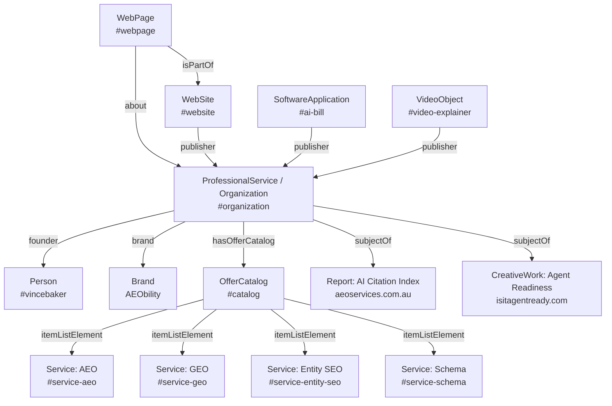

# AEObility Schema & Structured Data Implementation

> **Framework:** Next.js 15+ (App Router) • React 19 • Schema.org JSON-LD  
> **Repository:** `c:/Users/vince/agy2/projects/aeobility`  
> **Target Standard:** Schema.org Full Vocabulary • Google Structured Data Guidelines • NLWeb & ACP  
> **Locale & Currency:** Australian English (`en-AU`) • Australian Dollars (`AUD`, GST Exclusive)  
> **Validation Status:** 0 Errors, 0 Warnings across all audited production graphs.

---

## 1. Executive Summary & Structured Data Philosophy

AEObility approaches search engine visibility from an **Answer Engine Optimisation (AEO)** and **Generative Engine Optimisation (GEO)** perspective. Structured data is not an afterthought or a superficial Rich Snippet hack; it is the **authoritative semantic spine** of the entire website.

### Core Architectural Principles
1. **Tri-Graph Architecture:** The schema cleanly decouples into three interconnected graphs:
   * **Entity Graph (What exists):** Declares organisations, founders, software applications, services, and locations.
   * **Semantic/Intent Graph (How concepts link):** Defines relationships, taxonomy, concept articles, and terminology sets.
   * **Evidence Graph (Where claims are proven):** Anchors empirical case studies, third-party benchmarks, and registry records.
2. **Entity-Relationship-Evidence Framework:** Every commercial offering is mapped as an explicit machine-readable triple:
   $$\text{Entity } (\text{/services/aeo\#service}) \longrightarrow \text{Relationship } (\text{/services/aeo/definition}) \longrightarrow \text{Evidence } (\text{/knowledge-hub/case-studies/baby-bento})$$
3. **Absolute URI Canonical Integrity:** Every `@id` tag and node cross-reference across all schemas must use a fully-qualified absolute canonical URI (`https://aeobility.com.au/...`). Relative paths in `@id` attributes are strictly prohibited and enforced via automated pre-commit scanning.
4. **Server Component Direct Injection:** All page-level JSON-LD schemas are rendered directly inside Next.js 15 Server Components via static `<script type="application/ld+json">` tags, ensuring zero client hydration delays and guaranteed indexing by search crawlers.

---

## 2. Current Schema Injection Setup Across Pages

Schema injection in AEObility is structured into three clean operational patterns:

```
┌────────────────────────────────────────────────────────────────────────┐
│                      AEObility Schema Injection Layers                 │
├────────────────────────────────────────────────────────────────────────┤
│ Layer 1: Global Site Layout (RootLayout)                               │
│          └── SiteNavigationSchema.tsx -> outputs #sitenav              │
│ Layer 2: Page-Level Server Component Graph (page.tsx)                  │
│          ├── Homepage -> 10-Node Unified Tri-Graph                     │
│          ├── Service Pages -> Dedicated Graph Builders (src/lib/schema)│
│          └── Articles & Utility -> Bespoke Inlined JSON-LD Graphs      │
│ Layer 3: Component-Level Structured Leaf Elements                      │
│          ├── Breadcrumbs.tsx -> BreadcrumbList                         │
│          └── CapabilityMatrix.tsx -> ItemList                          │
└────────────────────────────────────────────────────────────────────────┘
```

### Pattern A: Centralised Reusable Schema Builders (`src/lib/schema/*`)
Used across core commercial pillars and local metro landing corridors. The Server Component imports a typed builder function, passes dynamic parameters (such as FAQs or metro configs), and injects the resulting object:

```tsx
// Example from src/app/services/aeo/page.tsx:
import { getCanonicalAeoSchemaGraph } from '@/lib/schema/canonicalAeo';

export default function CanonicalAeoPage() {
  const jsonLdGraph = getCanonicalAeoSchemaGraph(faqs);

  return (
    <div className="min-h-screen bg-black text-white flex flex-col">
      <script
        type="application/ld+json"
        dangerouslySetInnerHTML={{ __html: JSON.stringify(jsonLdGraph) }}
      />
      {/* ...page content... */}
    </div>
  );
}
```

### Pattern B: Root Unified `@graph` (Homepage Architecture)
The homepage (`src/app/page.tsx`) consolidates all root brand, service, product, and media entities into a single unified `@graph` array within one server-rendered `<script>` block. This prevents orphan schema nodes and ensures conversational AI engines understand the full interconnected enterprise in a single parse pass.

### Pattern C: Layout-Level Global Navigation Graph (`SiteNavigationSchema.tsx`)
Injected once in `src/app/layout.tsx` via `src/components/navigation/SiteNavigationSchema.tsx`. It pulls structured navigation items from `src/components/navigation/NavData.ts` and outputs a comprehensive `SiteNavigationElement` declaring all canonical top-level sections and child corridors.

### Pattern D: Contextual Leaf Component Schemas
* **`src/components/Breadcrumbs.tsx`:** Automatically generates an absolute `BreadcrumbList` matching the URL path hierarchy.
* **`src/components/CapabilityMatrix.tsx`:** Injects an `ItemList` schema defining the 3x4 capability matrix comparing AEO vs. SEO vs. GEO across technical dimensions.

---

## 3. Dedicated Schema Graph Builders (`src/lib/schema/`)

The directory [`src/lib/schema/`](file:///c:/Users/vince/agy2/projects/aeobility/src/lib/schema/) houses typed schema graph builders for primary commercial corridors:

| File Name | Primary Export Function | Target Schema Nodes Generated | Consumer Route(s) |
| :--- | :--- | :--- | :--- |
| [`canonicalAeo.ts`](file:///c:/Users/vince/agy2/projects/aeobility/src/lib/schema/canonicalAeo.ts) | `getCanonicalAeoSchemaGraph(faqs)` | `Service`, `Organization`, `Person`, `ImageObject`, `OfferCatalog`, `FAQPage`, `WebPage` | `/services/aeo` |
| [`localMetroAeo.ts`](file:///c:/Users/vince/agy2/projects/aeobility/src/lib/schema/localMetroAeo.ts) | `getLocalMetroSchemaGraph(config, faqs)` | `LocalBusiness`, `areaServed` (`City`, `AdministrativeArea`, `Country`), `geoCoordinates`, `Service`, `OfferCatalog`, `FAQPage`, `WebPage` | `/services/ai-search-marketing/{adelaide, brisbane, melbourne, perth, sydney}` |
| [`geoMarketing.ts`](file:///c:/Users/vince/agy2/projects/aeobility/src/lib/schema/geoMarketing.ts) | `getGeoMarketingSchemaGraph(faqs)` | `Service`, `OfferCatalog`, `FAQPage`, `WebPage`, `about` -> `#organization` | `/services/geo-marketing` |
| [`aeoBlueprint.ts`](file:///c:/Users/vince/agy2/projects/aeobility/src/lib/schema/aeoBlueprint.ts) | `getAeoBlueprintSchemaGraph(faqs)` | `Product` (`sku: BPSTRAT`, $995 AUD), `Offer`, `FAQPage`, `BreadcrumbList` | `/solutions/aeo-blueprint` |
| [`aeoSprint.ts`](file:///c:/Users/vince/agy2/projects/aeobility/src/lib/schema/aeoSprint.ts) | `getAeoSprintSchemaGraph(faqs)` | `Product` (Macro & Micro Sprints), `OfferCatalog`, `FAQPage`, `WebPage` | `/solutions/aeo-sprint` |
| [`solutions.ts`](file:///c:/Users/vince/agy2/projects/aeobility/src/lib/schema/solutions.ts) | `getSolutionsSchemaGraph(faqs)` | `CollectionPage`, `ItemList`, `hasPart`, `FAQPage` | `/solutions` |
| [`shopifyAeo.ts`](file:///c:/Users/vince/agy2/projects/aeobility/src/lib/schema/shopifyAeo.ts) | `getShopifyAeoSchemaGraph(faqs)` | `Service` (Shopify AEO), `Product`, `OfferCatalog`, `FAQPage` | `/services/aeo/shopify` |
| [`localBusinessAeo.ts`](file:///c:/Users/vince/agy2/projects/aeobility/src/lib/schema/localBusinessAeo.ts) | `getLocalBusinessAeoSchemaGraph(faqs)` | `LocalBusiness`, `Service`, `OfferCatalog`, `FAQPage` | `/services/aeo/local-business` |
| [`aiSearchMarketing.ts`](file:///c:/Users/vince/agy2/projects/aeobility/src/lib/schema/aiSearchMarketing.ts) | `getAiSearchMarketingSchemaGraph(faqs)` | `Service`, `OfferCatalog`, `FAQPage`, `WebPage` | `/services/ai-search-marketing` |
| [`aeoComparison.ts`](file:///c:/Users/vince/agy2/projects/aeobility/src/lib/schema/aeoComparison.ts) | `getAeoComparisonSchemaGraph(faqs)` | `Article`, `Table` (Structured comparison matrix), `FAQPage` | `/services/aeo/comparison` |
| [`aeoProcedures.ts`](file:///c:/Users/vince/agy2/projects/aeobility/src/lib/schema/aeoProcedures.ts) | `getAeoProceduresSchemaGraph(faqs)` | `HowTo`, `HowToStep`, `HowToSupply`, `FAQPage` | `/services/aeo/procedures` |

---

## 4. Central Entity Definitions & Brand Knowledge Files

AEObility maintains a strict Single Source of Truth (SSOT) hierarchy for brand identity, pricing, ontologies, and vector search embeddings:

```
┌────────────────────────────────────────────────────────────────────────┐
│                 Central Entity & Knowledge SSOT Hierarchy              │
├────────────────────────────────────────────────────────────────────────┤
│ 1. AEObility -IA & SLM.csv (Root Master IA & Ontology Lattice)         │
│    ├── scripts/generate-navdata.mjs -> src/.../navigation/NavData.ts   │
│    └── scripts/build-knowledge-base.mjs -> src/.../knowledgeBase.json  │
│                                                                        │
│ 2. src/lib/pricing.ts (Commercial SKUs, Tiers, Governance SSOT)        │
│    └── Sourced by brandFacts.ts, solutions pages, and API handlers     │
│                                                                        │
│ 3. src/lib/brandFacts.ts (Canonical Brand Knowledge Layer - CBKL)      │
│    ├── Legal registry: ABN 61 029 803 255, ASIC 2026-07-21             │
│    ├── Identity disambiguation (Distinct from Seobility)               │
│    ├── Verified Provenance Entities (First-party verified facts)       │
│    └── PUBLIC_SCHEMA_GRAPH (Imported in /brand-facts)                  │
│                                                                        │
│ 4. src/lib/brandGuidelines.ts (Tone of Voice Specification)            │
│    └── Schema: https://schema.aeobility.com/tov                        │
│                                                                        │
│ 5. public/brand-facts.json & public/brand-tov.json                     │
│    └── Static machine-readable JSON-LD endpoints for external agents   │
└────────────────────────────────────────────────────────────────────────┘
```

### Detailed Breakdown of Master Entity Files

#### 1. `src/lib/brandFacts.ts` (Canonical Brand Knowledge Layer - CBKL)
Over 1,000 lines of verified factual declarations. Exports:
- **`BRAND_FACTS`**: Primary ground truth used across the site:
  * `legalName`: `"AEObility"`
  * `legalStructure`: `"Registered Australian Business Name"`
  * `abn`: `"61 029 803 255"` (linked to ABR canonical URL)
  * `registrationDate`: `"2026-07-21"`
  * `registeringBody`: `"Australian Securities and Investments Commission (ASIC)"`
  * `principalPlaceOfBusiness`: Dianella, Western Australia, 6059, AU
  * `holder`: Vincent Anthony Baker (Proprietor / Founder)
  * `pronunciation`: `"A-E-O-bility"`
  * `etymology`: `"Portmanteau of Answer Engine Optimisation (AEO) and ability"`
  * `disambiguation`: Explicit declaration that AEObility is an independent Australian consultancy completely distinct from Seobility software.
  * `knownAliases`: `["AEO Bility", "aeo bility", "aeo.bility", "AEO.bility"]`
  * `sameAs`: 8 verified registry and authority URLs (ABR, Crunchbase, CB Insights, ProductHunt, LinkedIn, Dev.to, GitHub, Google Maps).
- **`BRAND_IDENTITY`**: Phone numbers, support emails, hours of operation, and Australian legal jurisdiction.
- **`BRAND_DEFINITIONS`**: Machine-readable glossary defining AEO, GEO, Semantic Triples, Knowledge Graph Engineering, Entity Density, and Machine Legibility.
- **`PROVENANCE_ENTITIES`**: First-party verified factual claims with timestamps, source URLs, and proof classifications (`FirstPartyPage`, `CorporateRegistry`, `TechnicalDocumentation`, `CaseStudy`).
- **`PUBLIC_SCHEMA_GRAPH`**: The complete interoperable JSON-LD graph imported and rendered by the `/brand-facts` page.

#### 2. `src/lib/pricing.ts` (Commercial Sprint Pricing Architecture)
Over 700 lines defining all commercial offerings, pricing structures, and contractual rules:
- **`TECHNICAL_SPRINT_CATALOG`**: Typed catalog of all billable SKUs:
  * `BPSTRAT`: Strategic Blueprint ($995 AUD ex GST, 5 business days)
  * `AEO-FOUNDATION-DIRECT`: AEO Foundation Direct ($1,990 AUD ex GST, 10 business days)
  * `AEO-FOUNDATION-IMPL`: AEO Foundation Implementation ($3,485 AUD ex GST, 14 business days)
  * Macro Sprints ($1,495 AUD ex GST)
  * Micro Sprints ($495 - $750 AUD ex GST)
- **`PRICING_TIERS`**: Formatted pricing tiers powering `/solutions` and pricing comparison cards.
- **`GOVERNANCE_RULES`**:
  * 60-day credit window (100% of $995 Blueprint fee credited toward Foundation).
  * Out-of-scope hourly rate: $165 AUD/hr ex GST.
  * Fixed turnaround SLAs (5 to 14 business days).
  * 100% full IP and code transfer upon final payment with zero ongoing retainer lock-in.

#### 3. `src/lib/brandGuidelines.ts` (Tone of Voice & Behavioural Specification)
Implements the custom schema specification located at `https://schema.aeobility.com/tov`:
- **`AEOBILITY_TONE_OF_VOICE`**:
  * Core brand promise: *"Get Found. Get Chosen."*
  * Tagline: *"No jargon. No pressure. Just clarity."*
  * Five personality traits: Structured, HumanBuilt, Confident, Transparent, ModernTech.
  * Three voice pillars: Clarity, Trust, Momentum.
  * Strict grammar rules: Modern Australian English (`en-AU`), zero em dashes (`—`), outcome-driven verbs.

#### 4. `AEObility -IA & SLM.csv` & `src/lib/search/knowledgeBase.json`
* **Master CSV:** 48 entity nodes mapped across 5 classification layers (Core, Commercial, Concept, Intent, Evidence).
* **Compiled JSON (`knowledgeBase.json`):** Precompiled 384-dimensional dense vector embeddings generated via `scripts/build-knowledge-base.mjs`. Includes baseline statistical calibration:
  * $\mu_{\text{base}}$: Mean pairwise vector similarity across all 1,128 node pairs.
  * $\sigma_{\text{base}}$: Standard deviation of similarity distribution.
  * Dynamic Z-score thresholding ($Z \ge 1.0$) for intent retrieval.

#### 5. `src/components/navigation/NavData.ts`
Auto-generated from `AEObility -IA & SLM.csv` via `scripts/generate-navdata.mjs`:
* Contains the multi-level navigation tree (`NAVIGATION_DATA`).
* Contains `HUB_SUBNAV_MAPS` used to power contextual secondary navigation and breadcrumbs across all 60 pages.
* Feeds `SiteNavigationSchema.tsx` for layout-level structured data injection.

---

## 5. Homepage Five-Node Tri-Graph Architecture

The homepage (`src/app/page.tsx`) renders the primary root graph (`@graph`) establishing entity disambiguation and authority:



### The 5 Core Anchor Nodes

1. **Node 1: Organization / Brand Identity Anchor**
   * Types: `["Organization", "ProfessionalService", "LocalBusiness"]`
   * ID: `https://aeobility.com.au/#organization`
   * Properties: `name`, `legalName`, `alternateName`, `slogan`, `brand`, `taxID`, `foundingDate`, `address`, `geo`, `knowsAbout`, `sameAs`.
2. **Node 2: Value Proposition & Disambiguation**
   * Properties: `description`, `slogan` (*"Get Found. Get Chosen."*), `disambiguatingDescription` (formal separation from Seobility).
3. **Node 3: Primary Commercial Service Catalog**
   * Properties: `hasOfferCatalog` linking to 4 primary service nodes (`#service-aeo`, `#service-geo`, `#service-entity-seo`, `#service-schema`).
4. **Node 4: Geographic & Metro Anchor**
   * Properties: `address` (Dianella, WA 6059 AU), `geo` (Lat: -31.8900, Long: 115.8690), `areaServed` (Perth, Western Australia, Australia with Wikidata and Wikipedia anchors).
5. **Node 5: Authority, Trust & Third-Party Evidence**
   * Properties: `founder` (`https://aeobility.com.au/#vincebaker`), `taxID` (`ABN 61 029 803 255`), `sameAs` (8 links), `subjectOf` (2 independent third-party evidence nodes).

---

## 6. Build Hooks, Validation Scripts & Automated CI Checks

AEObility enforces schema validity and data consistency through automated scripts:

### 1. Prebuild Compilation (`scripts/build-knowledge-base.mjs`)
* Triggered automatically before every production build (`npm run build`).
* Compiles `AEObility -IA & SLM.csv` into `src/lib/search/knowledgeBase.json`.
* Recomputes all pairwise vector embeddings and Z-score similarity distributions.
* Calls `generateNavData()` to regenerate `src/components/navigation/NavData.ts`.

### 2. Absolute Schema URI Linter (`scripts/verify-absolute-schema-ids.mjs`)
* Scans all TypeScript and TSX files in `src/`.
* Audits all `@id`, `mainEntity`, `provider`, `publisher`, and `itemOffered` references.
* Fails the build if any relative URI (e.g. `"/#organization"`) is detected instead of fully-qualified absolute URIs (`"https://aeobility.com.au/#organization"`).

### 3. Brand Facts & Pricing SKU Validator (`scripts/validate-brand-facts.mjs`)
* Cross-validates `public/brand-facts.json` against all mandatory product SKUs (`BPSTRAT`, `SS1MACROS1`, `SS1MICRO1`, etc.).
* Validates that price fields are valid positive numbers, price currency is strictly `AUD`, and deliverables arrays are populated.

### 4. Comprehensive Production Health Audit (`scripts/project-health-audit.ps1`)
* Live endpoint crawler and schema integrity validator.
* Fetches production HTML from `https://aeobility.com.au/`.
* Parses all `<script type="application/ld+json">` tags using JSON schema reflection.
* Verifies presence and structure of all 5 homepage schema nodes, brand tone compliance, and asset link integrity.

---

## 7. Machine-Readable Agent Manifests & Interoperability

In addition to HTML-embedded JSON-LD, AEObility publishes root machine manifests for AI agent discovery:

| Manifest Path | Format / Standard | Strategic Purpose |
| :--- | :--- | :--- |
| [`/AGENTS.md`](file:///c:/Users/vince/agy2/projects/aeobility/public/AGENTS.md) | Markdown Grounding Spec | Natural language rules, Australian English standards, and brand grounding for autonomous coding and research agents. |
| [`/llms.txt`](file:///c:/Users/vince/agy2/projects/aeobility/public/llms.txt) | Compact Text Standard | Curated Markdown context file outlining core entity definitions, services, and pricing for LLM prompt context injection. |
| [`/llms-full.txt`](file:///c:/Users/vince/agy2/projects/aeobility/public/llms-full.txt) | Expanded Text Standard | Full documentation dump of articles, tutorials, and schemas for comprehensive RAG vector stores. |
| [`/brand-facts.json`](file:///c:/Users/vince/agy2/projects/aeobility/public/brand-facts.json) | Schema.org JSON-LD | Static JSON-LD `@graph` export of all verified products, offers, and commercial pricing specs. |
| [`/brand-tov.json`](file:///c:/Users/vince/agy2/projects/aeobility/public/brand-tov.json) | Custom JSON-LD Spec | Machine-readable Tone of Voice specification (`https://schema.aeobility.com/tov`). |
| [`/.well-known/ai-catalog.json`](file:///c:/Users/vince/agy2/projects/aeobility/public/.well-known/ai-catalog.json) | AI Catalog Spec | Declares available AI capabilities, MCP endpoints, and tool definitions. |
| [`/.well-known/poppy.json`](file:///c:/Users/vince/agy2/projects/aeobility/public/.well-known/poppy.json) | Personal Agent Protocol | Poppy protocol handshake definition for personalized assistant delegation. |
| [`/openapi.json`](file:///c:/Users/vince/agy2/projects/aeobility/public/openapi.json) | OpenAPI 3.1.0 | Machine-executable API definitions for diagnostic audits, search, and knowledge hub queries. |
